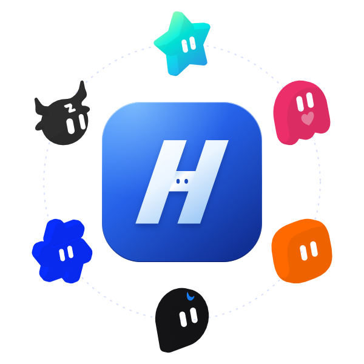
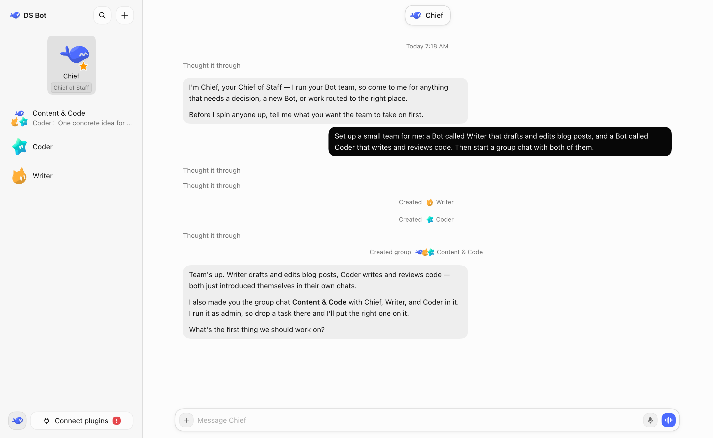
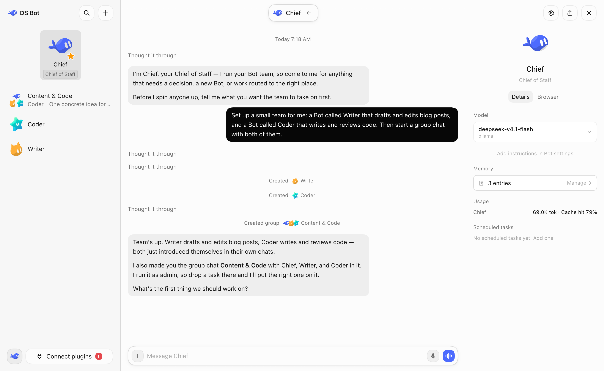
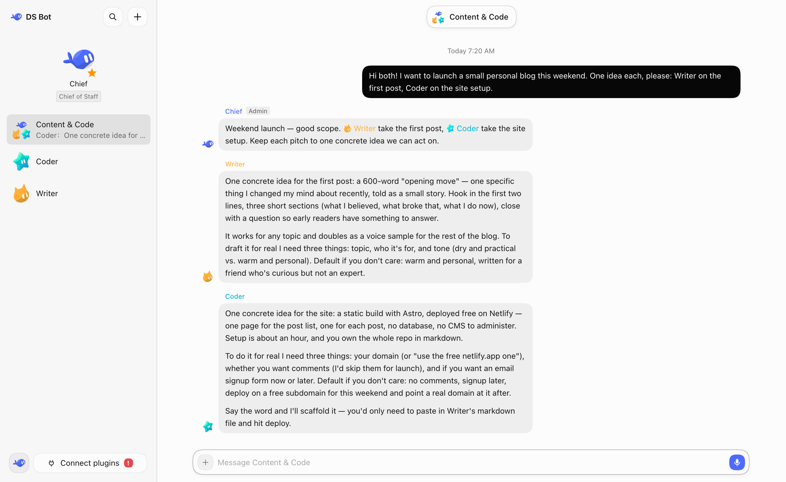
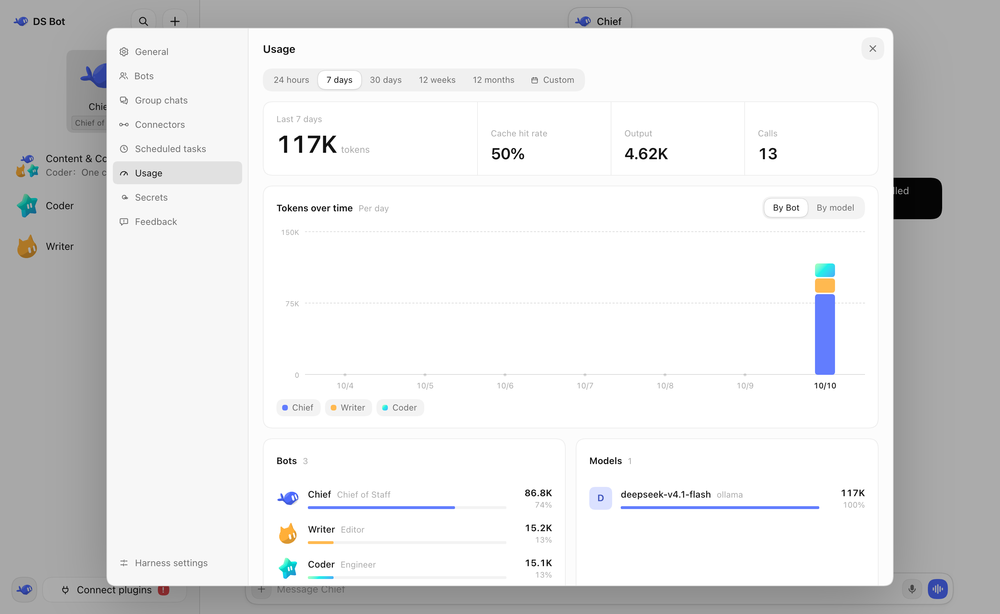

<p align="center"><picture><source media="(prefers-color-scheme: dark)" srcset="docs/images/logo-dark.svg"></picture></p>

# H bot

English | [中文](README.zh.md)

 

H bot is a local AI assistant you run on your own computer. You create bots, talk with them, and let them work together in group chats. The desktop app brings its own runtime, so you can set up a model and start using it without installing anything else first.

This repository is a secondary-development fork of [DS Bot](https://github.com/Fei2411/DS-Bot), built on [DeepSeek Harness](https://github.com/deepseek-ai/deepseek-harness) (DSH). Original author attribution is kept in [LICENSE](LICENSE) and [NOTICE](NOTICE).



## Install

The current release path is the Windows desktop app. This repository does not have a published installer yet. On Windows, pack one from source:

```powershell
./build-exe.ps1
```

That builds the open edition Windows installer. If Windows blocks the unsigned app, select **More info** → **Run anyway**. After install, choose a model in Settings. You can also copy an existing bot team from DSH if you already have one.

For Docker (NAS or a Linux server), see [`docker/README.md`](docker/README.md).

## Setup

The easiest way to set up other bots and group chats is to talk to the main bot and let it walk you through it.

### Web search

H bot uses the `auto` search provider for the whole profile. If you turn off `web-search-auto`, also pick another registered search provider in that profile. See [Web search](ds-bot/README.md#web-search) and the [recovery steps](docs/known-issues.md#web-search-fails-everywhere-after-turning-off-web-search-auto).

## Features

### Bot

You can do all your talking and work with one bot in one window, without managing the context behind it. On the bot's details page you can see its info and pick the model and thinking level. You can switch models at any time, but it is usually better to keep one model on a bot for a long time and change it only when you need to.

Bots also have memory. A bot remembers what you like and uses it later. You can manage that memory on the details page, or just tell the bot.

Each bot can have its own working folder and permission preset — tell the bot when you want to switch folders. While it is working, you can send a message to steer it, or type `/side` to ask a side question without interrupting the task. It can draw charts, tables and forms in its replies, and it can run scheduled tasks. In the sidebar, you can group bots and group chats into collapsible sections by work.



### Main bot

The main bot is your chief. It has high rights: it manages the other bots and the group chats. The first time you open H bot, there is already a main bot called Chief. Talk to it, and it walks you through setup.

In short: if you have a question, ask the main bot.

### Group chats

A group chat is a good way to get several bots to work together, but it clearly costs more. Every group chat has an admin. The admin answers your messages by default and calls in the other bots for you. You can also @ a bot directly, and it answers you directly. To give the bots another chat as context, use + → Reference a chat in the message box.

Any bot can hand work to other bots with @. Those bots do the work on their own and post the results back to the group. A group chat has its own memory and working folder, invisible to bots outside the group. For larger work, a group chat can run a Goal: the admin aligns with you on what "done" means, splits the work into stages across members, and checks each stage before moving on.



### Private bot

If you have private work that you only want to discuss with one bot, turn on Private in its settings and give it a separate working folder. Other bots cannot read its folder, memory or chat history, and sending messages to other bots or writing files outside its folder requires your approval. Even if you delete it, its folder and records stay protected until you release them in Settings.

A private bot cannot be a main bot or join group chats. This boundary only isolates it from other bots in your team, not as an OS sandbox: if you give it shell or network access, its commands can still read and write system files or reach the network, and its model provider still receives the conversation.

### Local agents

Coding-agent CLIs you already use on your computer (Claude Code, Codex CLI, Cursor CLI, Devin CLI, OpenCode, Gemini CLI and others) can be connected as bots directly. Pick Local agent when creating a bot (or switch in the bot's settings), and it will use the CLI's own sign-in, plan and models while working like any other bot in private chats, group chats, handoffs and memory.

A few limits: a local agent uses the CLI's own tools and context, so shared capabilities and connectors in H bot are not passed to it, and switching how a bot runs starts a fresh conversation part. Custom CLIs without HTTP MCP support do not get team tools such as creating bots or handing off work. Also, Cursor CLI saves the last selected model as its own global default (`~/.cursor`), so if you pick a specific model for a Cursor bot in H bot, other Cursor bots on the default model and Cursor in your terminal will switch to it too — keep "CLI default" if you don't want to change your global default (sign in to Cursor first so the model list loads).

### Browser

Each bot has its own isolated browser with separate sign-ins, and can import cookies from a file or from your local browsers. Turn on a browser plugin in Settings → Browser to let bots open and operate web pages on their own; posting, uploading, downloading and deleting need your approval, and sign-in, captchas or payments hand back to you with a card so you can take over and hand back at any time.

The browser feature is available in the desktop app and DSH Desktop only (not in DSH Web), and only the desktop app keeps browser sign-ins after you quit and supports cookie import. On Windows, new Chrome and Edge cookies encrypted with v20 cannot be read directly — export them to a file with a browser extension first.

### Computer use

Turn on Settings → Computer use to let bots operate apps on your computer as far as you allow. You can set a level (view only, background, or foreground) and allowed apps for each bot, with a top bar showing when a bot is working so you can pause or take over at any time; apps like system settings and password managers are never given to a bot.

All bots share your desktop, so only one bot can use a given app or the foreground mouse at a time. On Windows, Chrome and Electron apps often ignore background input and need "foreground", and apps running as administrator cannot be controlled; macOS requires 14 or later with Accessibility and Screen Recording permissions; Linux supports X11, with limited Wayland support.

### IM

In Settings → IM, you can link a bot or group chat to WeChat, Feishu, DingTalk, WeCom, QQ, Telegram, Discord or Slack. Once paired, you can talk to your bots, @ them in groups, and answer question and approval cards directly from your chat app without a public IP or open port on your computer.

Messages only flow while your computer is awake and H bot is running. WeChat only supports private chat with the QR-paired account, not group chats; WeChat and QQ only allow replies within a platform time window after you send a message, and sending another message resumes it. WeChat, QQ and DingTalk do not have card buttons, so reply with the option number instead; for security, secret cards cannot be filled in from chat apps.

### Connectors and capabilities

In Settings → Connectors, you can sign in to GitHub, Gmail, QQ Mail, 163 and other mailboxes, and remote MCP servers, or import existing configs from Claude Desktop, Cursor and VS Code. Credentials stay in H bot's secrets so bots never see the raw values, and emails written by a bot wait for your confirmation by default.

In Settings → Capabilities, you can manage shared MCP servers, skills and packs for the team and enable them per bot; local commands added by a bot need your approval before they run.

### Office files

Bots can create, check and edit Word (`.docx`), PowerPoint (`.pptx`) and Excel (`.xlsx`) documents directly, and render pages to images to check layout. The desktop app includes the full runtime out of the box.

### Usage

In **Settings** → **Usage**, you can see token usage by time, by bot and by model.



## Data

All data stays on your own computer, in the folder you chose on first start (default `~/.ds-bot`). Uninstalling the app does not delete this data.

## Development

Plugin source is in [`ds-bot/`](ds-bot/). For options and internals, see [`ds-bot/README.md`](ds-bot/README.md). For development, tests and how the team works, see [CONTRIBUTING.md](CONTRIBUTING.md). For changes between versions, see [CHANGELOG.md](CHANGELOG.md).

To run from this repository on Windows, use `./start.ps1`.

## Acknowledgments

- [DS Bot](https://github.com/Fei2411/DS-Bot): H bot is based on this project. Copyright 2026 Fei2411 and the DS Bot contributors; see [LICENSE](LICENSE) and [NOTICE](NOTICE).
- [DeepSeek Harness](https://github.com/deepseek-ai/deepseek-harness): the plugin system, sessions, tools and models that bots run on.
- [esbuild](https://esbuild.github.io/): bundles the plugin's interface code.
- Thanks to these projects for the ideas they published. The upstream project learned from their designs and does not contain their code:
  - [AgentMemoryRepo](https://github.com/AgentMemoryRepo/agentmemoryrepo): the Markdown format of bot memory.
  - [OpenAI Codex](https://github.com/openai/codex): checkpoints that keep the user's messages next to the summary, and message anchors for chat search.
  - [OpenMausBot](https://github.com/milind-soni/OpenMausBot): group chat rounds and @mention relays.
  - [Hermes Agent](https://github.com/NousResearch/hermes-agent) and [Hermes Bot Mode](https://github.com/NousResearch/Hermes-Bot-Mode): one session per member per group chat, and handoffs that carry the earlier user messages.
  - [OpenCode](https://github.com/sst/opencode), [goose](https://github.com/block/goose), [pi](https://github.com/badlogic/pi-mono) and [Gemini CLI](https://github.com/google-gemini/gemini-cli): when to condense a long chat, and what a handoff note holds.
  - [obelisk](https://github.com/tommy0103/obelisk): chat search with a SQLite full-text index.

## License

[Apache License 2.0](LICENSE). Provided "as is", without any warranty. Third-party code and its license are listed in [NOTICE](NOTICE).

## Disclaimer

H bot is an independent secondary-development project. **It is not an official DeepSeek product**, and it is not affiliated with, endorsed by or sponsored by DeepSeek. It is also not the official DS Bot project. "DeepSeek", "DeepSeek Harness" and the other names are trademarks of their owners. They are used here only to say what this project is based on and works with.

Bots use your own model quota, and they read and write files and run commands when you ask them to. Check important actions yourself.
